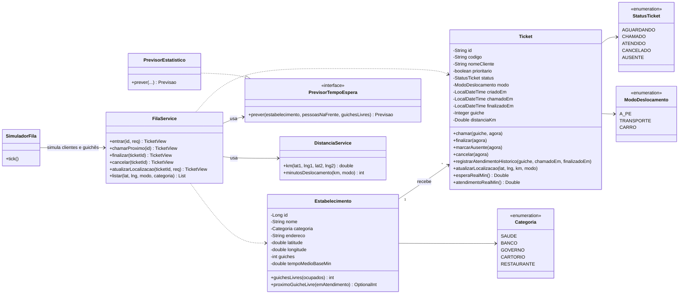
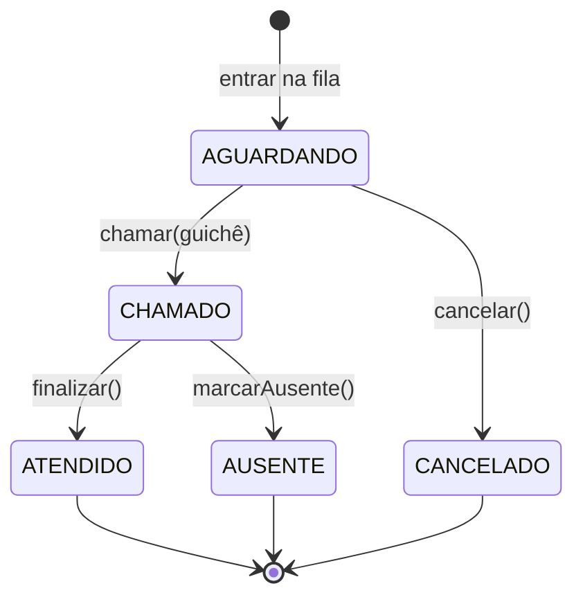
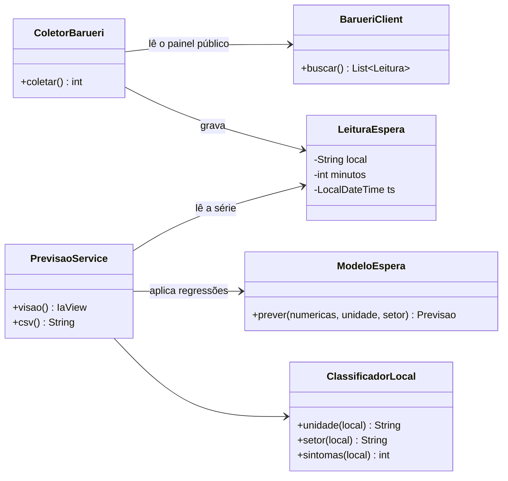
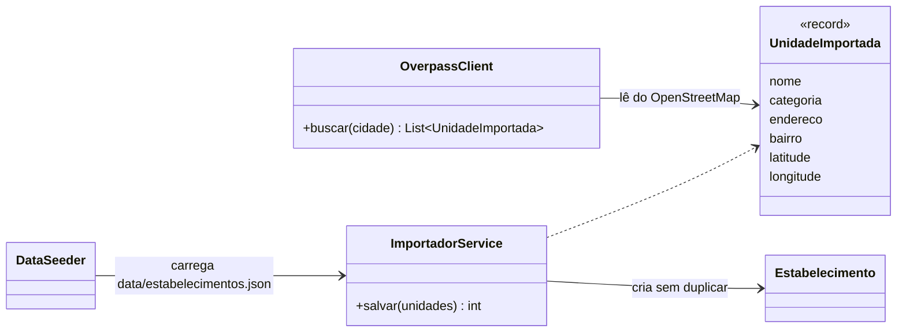

# Modelo de domínio — Fila Certa

O domínio gira em torno de **quem espera** (`Ticket`) e **onde espera** (`Estabelecimento`). As regras vivem em serviços (`FilaService`), não nos controllers, e a previsão de espera é uma **interface** que pode ser trocada.

## Diagrama de classes

## Ciclo de vida do ticket

As transições de status são **métodos do próprio `Ticket`**, e não setters: só é possível chegar a um estado válido. Uma tentativa inválida lança `RegraDeDominioException` (HTTP 422) e não altera o ticket.

Invariantes protegidas pelas entidades:
- `Ticket`: nome obrigatório (até 60 caracteres, aparado); só chama quem aguarda; o guichê precisa existir no estabelecimento; datas do histórico em ordem.
- `Estabelecimento`: nome e categoria obrigatórios, coordenadas válidas, ao menos um guichê, tempo de atendimento positivo; sabe dizer quantos guichês estão livres e qual é o próximo.

## Módulo de previsão (Machine Learning)

## Responsabilidades

| Camada | Classes | Papel |
|---|---|---|
| Domínio | `Estabelecimento`, `Ticket`, enums, `RegraDeDominioException` | Estado, invariantes **e regras** (ciclo de vida do ticket, escolha de guichê). Sem setters de estado. |
| Serviço | `FilaService`, `MetricasService`, `DistanciaService`, `PrevisaoService` | Orquestra o domínio (busca, chama a entidade, salva) e faz os cálculos (hora de sair, economia, previsão). |
| Persistência | `*Repository` (Spring Data JPA) | Acesso a dados (H2; trocável por Oracle/PostgreSQL). |
| Interface | Controllers REST + front estático | API demonstrável e telas. |
| Integração | `BotExterno`, `BotLocal`, `ColetorBarueri`, `ModeloEspera` | Bot de suporte, painel de Barueri e modelo de ML. |

## Decisões de modelagem

- **Interface `PrevisorTempoEspera`:** a fila local usa média móvel; um modelo de ML pode substituí-la com `@Primary`, sem mexer em `FilaService`.
- **Interface `BotAtendimento`:** duas implementações (`BotExterno`, `BotLocal`); `BotService` escolhe e faz fallback.
- **`Ticket` guarda a localização do cliente:** é a métrica de localização que alimenta o "hora de sair" e as métricas de distância.
- **`ModeloEspera` é lido de JSON:** os modelos são lineares, então não é preciso embutir Python; a equivalência com o scikit-learn é testada.

## Importação de estabelecimentos reais

Nome, endereço e coordenadas são reais (OpenStreetMap). Guichês e tempo médio de atendimento são **estimados** por tipo de lugar, porque a fonte não os informa.
